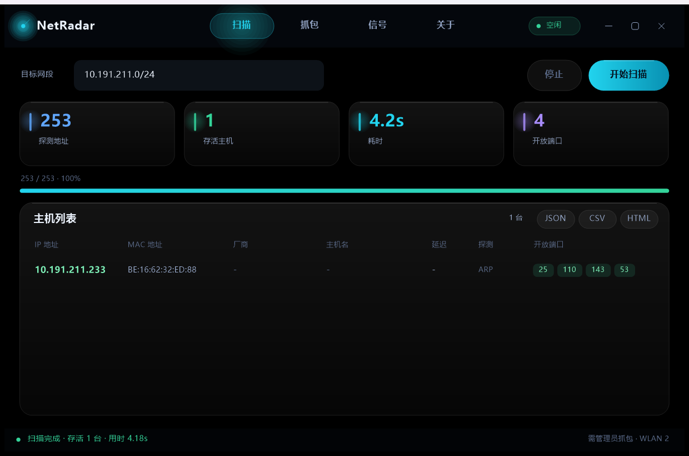
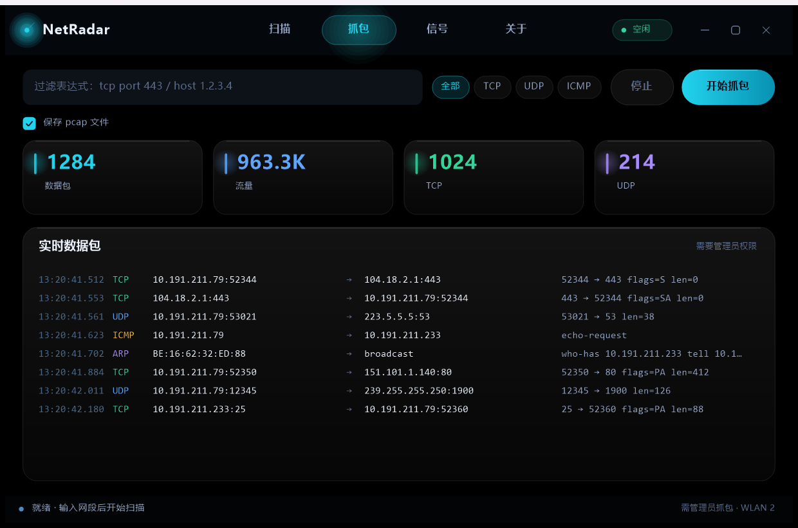
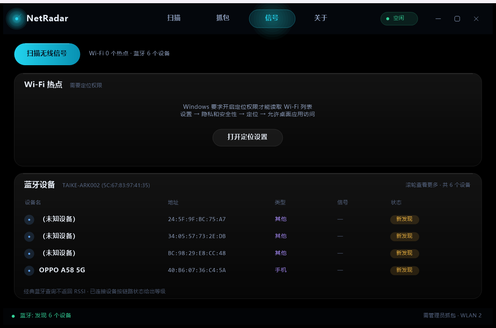
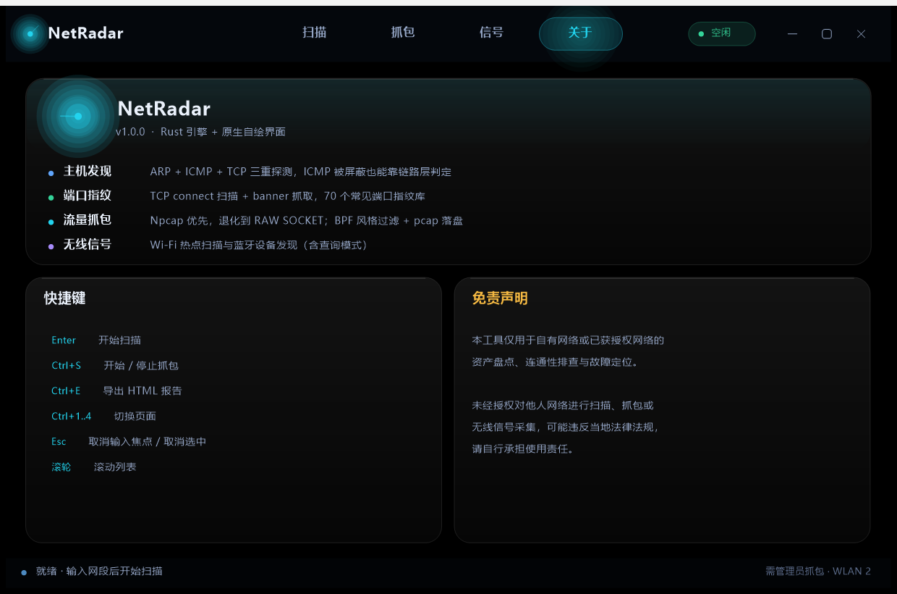
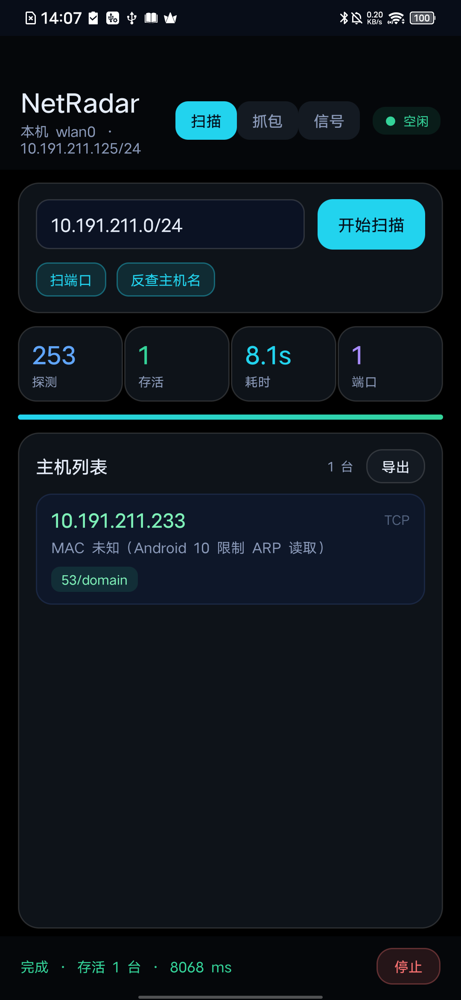
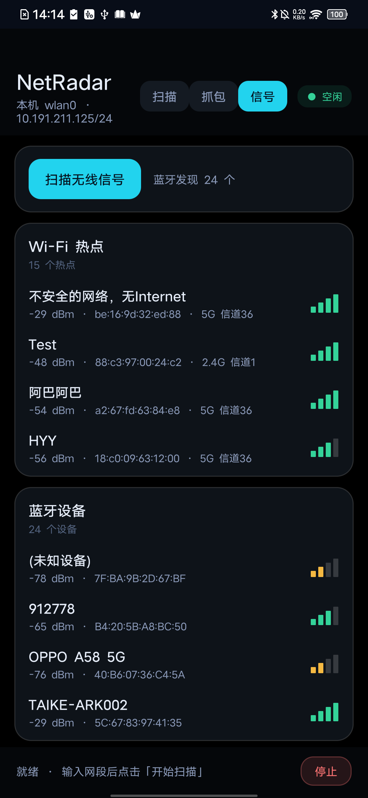

# NetRadar — 网络发现器 / 端口扫描 / 抓包 / 无线信号

> Rust 引擎 + 原生自绘界面。一套内核，三个产物：
> **`NetRadar-1.0.0-win64.exe`**（桌面应用）、**`netradar-cli-1.0.0-win64.exe`**（命令行）、**`NetRadar-1.0.0-arm64.apk`**（安卓）。



---

## 1. 桌面应用：纯黑 + 液态玻璃

* **布局重构**：左侧边栏改为顶部胶囊导航（扫描 / 抓包 / 信号 / 关于），内容区横向铺满，
  表格列宽按窗口宽度自适应，小窗不再挤压。
* **纯黑背景**：`#000000`，层次全部交给玻璃卡片与高光，不再有背景光晕干扰内容。
* **液态玻璃卡片**：半透明白色渐变 + 1px 高光描边 + 顶部镜面高光 + 柔和投影（多层低透明度圆角矩形）。
* **圆角规范**：窗口 Win11 圆角（`DwmSetWindowAttribute`），卡片 18–20px，按钮/输入框 10px，胶囊 = 全圆角。
* **线性动画**：
  * 页面切换：卡片按 55ms 间隔错峰滑入 + 淡入（320ms ease-out）
  * 导航指示器在四个标签间滑动插值（260ms）
  * 控件悬停 140ms 渐变；按钮/输入框/胶囊都有
  * 进度条、KPI 数字用指数逼近平滑追踪（不是跳变）
  * 新数据包到达时整行高亮脉冲衰减；状态点呼吸；雷达扫描线旋转
* **DPI 适配**：按 `GetDpiForWindow` 设置 GDI+ 世界变换，布局在逻辑坐标下进行；
  125% / 150% 缩放下界面**铺满窗口**，不再缩在左上角。
* 单文件 exe，~660 KB，无 Electron / Qt / .NET / 运行库依赖。



### 新增：无线信号页



* **Wi-Fi 热点扫描**（`wlanapi.dll`）：SSID / **信号强度条 + dBm** / BSSID / 信道 / 加密方式，已连接高亮。
  > Windows 10 1903+ 起系统强制要求**定位权限**才能读 Wi-Fi 列表（`netsh wlan` 同样被拦）。
  > 界面会显示明确说明并提供「打开定位设置」一键跳转。
* **蓝牙设备发现**（`BluetoothAPIs.dll`）：先枚举无线电（名称/MAC），再以查询模式扫描附近设备，
  显示设备名、地址、类型（手机/电脑/音频…）、**信号**、状态（已连接/已配对/新发现），支持滚轮滚动。
  > 经典蓝牙查询（`BluetoothFindFirstDevice`）**不返回 RSSI**，所以桌面端只有「已连接」设备能给出链路等级，
  > 其余显示 `—` 并在卡片底部注明；**Android 端能拿到真实 RSSI**（见下表）。

#### 信号强度换算（三端统一）

| dBm | 信号格 | 颜色 |
|---|---|---|
| ≥ -55 | ▮▮▮▮ | 绿 |
| ≥ -67 | ▮▮▮▯ | 绿 |
| ≥ -78 | ▮▮▯▯ | 黄 |
| ≥ -89 | ▮▯▯▯ | 红 |
| < -89 | ▯▯▯▯ | 红 |

| 平台 | Wi-Fi 信号 | 蓝牙信号 |
|---|---|---|
| Windows GUI / CLI | ✅ dBm + 信号格 | ⚠ 仅已连接设备给等级（API 限制） |
| Android | ✅ dBm + 信号格 | ✅ 真实 RSSI（`EXTRA_RSSI`）|




---

## 2. 三个产物

| 文件 | 说明 |
|---|---|
| `NetRadar-1.0.0-win64.exe` | **桌面应用**（GUI，免安装） |
| `netradar-cli-1.0.0-win64.exe` | **命令行版**（脚本/自动化） |
| `NetRadar-1.0.0-arm64.apk` | **安卓安装包**（arm64-v8a，Android 7.0+，已签名） |
| `screenshots/` `samples/` | 界面截图 / 真实扫描输出样例 |

### Android 端（已在真机验证）

黑底玻璃卡片风格，三个分页：**扫描 / 抓包 / 信号**。

真机实测（vivo V1921A · Android 10 · arm64-v8a · 1080×2340）：

| 项目 | 结果 |
|---|---|
| 网段扫描 | 253 个地址 / 8.1 秒 / 发现网关 `10.191.211.233` 与其 53 端口 |
| Wi-Fi 扫描 | 13 个热点（SSID / RSSI / BSSID / 频段信道） |
| 蓝牙发现 | 9 个设备（含手机、笔记本、手环） |
| 抓包页 | VpnService 就绪，等待授权 |




安装：

```bash
adb install -r dist\NetRadar-1.0.0-arm64.apk
adb shell am start -n com.netradar.app/.MainActivity
```

> **手动安装装不上的话**：vivo/Funtouch 默认会拦「未知来源」应用，需要在
> 设置 → 更多设置 → 权限管理 → 安装未知应用 里给文件管理器/浏览器授权；
> 或者直接用上面的 `adb install`（已实测可装）。
> Android 10 出于隐私限制不再允许普通应用读 `/proc/net/arp`，所以手机端
> 拿不到对端 MAC —— 界面会明确写「MAC 未知（Android 10 限制 ARP 读取）」，
> 不伪装成 `-`。


---

## 3. 功能矩阵

| 能力 | 桌面 GUI | 命令行 | Android |
|---|---|---|---|
| 存活主机发现（ARP / ICMP / TCP） | ✅ | ✅ | ✅ |
| MAC + 厂商识别（200+ OUI） | ✅ | ✅ | ✅ |
| 端口扫描 + banner 指纹 | ✅ | ✅ | ✅ |
| 抓包 + BPF 过滤 + pcap | ✅ | ✅ | ✅ |
| Wi-Fi 热点扫描 | ✅ | ✅（`--signals`） | ✅ |
| 蓝牙设备发现 | ✅ | ✅（`--signals`） | ✅ |
| 报告导出 | HTML/CSV/JSON | HTML/CSV/JSON | CSV |

### 快捷键（桌面）

| 按键 | 作用 |
|---|---|
| `Enter` | 开始扫描（当前页对应动作） |
| `Ctrl+S` | 开始/停止抓包 |
| `Ctrl+E` | 导出 HTML |
| `Ctrl+1..4` | 切换四个页面 |
| `Esc` | 取消焦点 / 取消选中 |

### 命令行

```powershell
netradar-cli-1.0.0-win64.exe -r 192.168.1.0/24 -p top100 --html r.html
netradar-cli-1.0.0-win64.exe -s 192.168.1.10 -p 1-1024
netradar-cli-1.0.0-win64.exe -c -f "tcp port 443" -n 50 -w https.pcap
netradar-cli-1.0.0-win64.exe --signals          # Wi-Fi + 蓝牙扫描
netradar-cli-1.0.0-win64.exe --ping 192.168.1.10
```

---

## 4. 架构

```
        ┌────────────────────────────────┐
GUI ───▶│ gui/  Win32 + GDI+ 自绘        │──┐
        │  ui.rs / page_*.rs / anim.rs    │  │
        └────────────────────────────────┘  ├──▶ core/ netradar-core
        ┌────────────────────────────────┐  │   （零第三方 crate）
CLI ───▶│ cli/  控制台 / REPL             │──┤
        └────────────────────────────────┘  │
        ┌────────────────────────────────┐  │
APK ───▶│ Java UI ──exec──▶ 同一引擎     │──┘
        └────────────────────────────────┘
```

* `core/src/scan.rs` — 三重探测、端口扫描、banner
* `core/src/capture.rs` — 报文解析、过滤、pcap、Npcap/RAW 后端
* `core/src/signals.rs` — Wi-Fi（wlanapi）与蓝牙（BluetoothAPIs）扫描
* `core/src/platform/` — Windows iphlpapi / Android getifaddrs
* `gui/src/gfx.rs` — GDI+ 封装（圆角、渐变、光晕、阴影、缩放）
* `gui/src/anim.rs` — 线性/缓出插值、指数逼近
* `gui/src/ui.rs` — 顶栏胶囊导航 + 通用控件；`ui/page_*.rs` 四个页面

**链接技巧**：工具链没有 gdi32/gdiplus/shell32 的导入库，
`build.rs` 把 `C:\Windows\System32\*.dll` 直接交给 rust-lld 生成导入，无需 MinGW。

---

## 5. 构建

```powershell
powershell -ExecutionPolicy Bypass -File build\build_all.ps1
```

工具链在 `_toolchain/`（Rust 1.99.1 gnullvm + NDK r25c + Android SDK 29），全程离线。

---

## 6. 已知限制

* Wi-Fi 列表受 Windows 定位权限限制（系统行为，非本程序）。
* BLE 广播嗅探需要专用硬件；本程序做的是经典蓝牙查询 + 适配器信息。
* 抓包需要管理员权限（或装 Npcap）。
* 扫描是 TCP connect 而非 SYN 半开。

---

## 7. 免责声明

本工具仅用于**自有网络或已获授权网络**的资产盘点与故障定位。
未经授权对他人网络进行扫描、抓包或无线信号采集可能违反法律法规，请自行承担使用责任。
